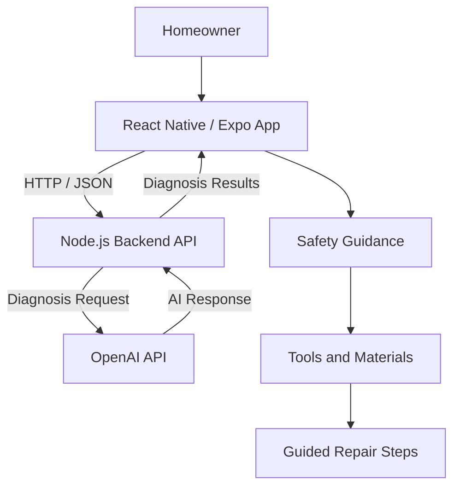

# D.A.D. — Diagnose And Do

### AI-Assisted Home Repair & Guided Troubleshooting

**D.A.D. (Diagnose And Do)** is a mobile application designed to help homeowners better understand household repair problems, identify potential causes, and navigate repairs through structured, step-by-step guidance.

The project combines AI-assisted diagnosis with organized repair workflows, safety information, and practical tools to make home maintenance more approachable.

**[▶ Watch the Application Demo](https://youtu.be/qZCoxYEJfx8)**

---

## Project Overview

Many homeowners encounter maintenance problems without knowing where to begin. Searching for solutions can mean navigating conflicting advice, technical terminology, and instructions that assume prior experience.

D.A.D. explores a more accessible approach by guiding users from describing a problem to understanding potential causes and reviewing practical repair instructions.

The goal is not to replace qualified professionals, but to help homeowners make more informed decisions about maintenance and repairs.

## Key Features

- **AI-Assisted Diagnosis:** Helps interpret user-reported household problems and suggest potential causes.
- **Guided Troubleshooting:** Organizes repair information into manageable, sequential steps.
- **Safety Guidance:** Presents relevant precautions before users begin repair work.
- **Tools and Materials:** Helps users identify what may be needed for a repair.
- **Visual Repair Instructions:** Supports guided steps with instructional imagery.
- **Repair History:** Provides a way to revisit previously recorded repair activity.
- **Mobile-Focused Interface:** Designed around an accessible, interactive repair experience.

## Technology Stack

| Layer | Technology |
|---|---|
| Mobile frontend | React Native, Expo |
| Application language | JavaScript / TypeScript |
| Backend | Node.js |
| AI integration | OpenAI API |
| Development tools | Visual Studio Code, Git, GitHub |
| Testing | Expo Web, mobile development environment |

## Application Workflow

1. **Identify a problem** — The user selects or describes a household maintenance issue.
2. **Explore potential causes** — AI-assisted diagnosis helps interpret the reported symptoms.
3. **Review safety precautions** — The application presents safety considerations.
4. **Prepare for the repair** — Users review the necessary tools and materials.
5. **Follow guided instructions** — Structured steps help users work through the repair.
6. **Track repair activity** — Repair information can be revisited for future reference.

## Architecture

D.A.D. separates the mobile user interface from its backend services.

The React Native frontend manages the user experience and communicates with a Node.js backend. The backend handles application requests and coordinates AI-assisted diagnosis through the OpenAI API.

This separation helps organize responsibilities and supports future development.

## Design and Development

D.A.D. is an independently developed project focused on combining practical problem-solving with modern application development.

Areas of development include:

- Designing a multi-screen mobile application
- Building reusable interface components
- Integrating frontend and backend services
- Working with external AI APIs
- Structuring guided repair workflows
- Implementing navigation and application state
- Troubleshooting cross-platform behavior
- Considering usability, safety, and future scalability

## Future Development

D.A.D. is an evolving project with a broader vision of becoming a trusted home-repair education platform.

Potential future improvements include expanding the repair knowledge library, developing more comprehensive troubleshooting workflows, and exploring ways to connect homeowners with qualified service professionals.

## Project Demonstration

**[Watch D.A.D. in Action on YouTube](https://youtu.be/qZCoxYEJfx8)**

The demonstration showcases the application's mobile interface and guided troubleshooting experience.

## Source Code

D.A.D. is maintained in a private development repository. This public repository serves as a portfolio showcase of the project's functionality, architecture, and development process.

---

*Developed as part of an ongoing exploration of mobile development, software architecture, and practical AI integration.*